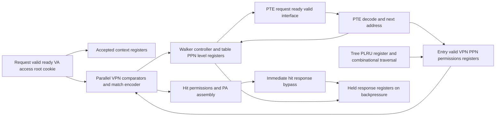

# Translation subsystem architecture

Status: architecture and experiment choices accepted on 2026-10-19, with a
combinational immediate-hit response required. Relevant course sources have now
been reviewed; see [source-review.md](source-review.md). Values marked **P** below are
explicit project choices accepted with that timing correction, not requirements
inferred from the course or a claim of complete ISA compliance. The requirements
matrix is in [verification.md](verification.md).

## Sources and required scope

The project proposal specifies SystemVerilog, ModelSim, a fully associative TLB,
tree pseudo-LRU replacement, a simplified multi-level hardware walker, and 4, 8,
and 16 entries with 4 as the baseline. Sequential, strided, random, and repeated
traces must be identical across capacities; page tables and memory latency remain
fixed. Metrics are hit rate, miss rate, translation latency, walk count, and
translation stall cycles. Zybo Z7-20 validation is optional.

The current project instructions add independent verification, cancellation,
complete observed transaction logs, exhaustive standalone PLRU checks, fault and
protocol stress, reproducible automation, and genuine simulator evidence. CPU/OS
integration, UVM, prefetch, walker caches, superpages, ASIDs, and virtualization
are excluded. There is no claim of implementing a complete RISC-V MMU.

The local proposal and guidelines have been read. Relevant textbook and lecture
sections have been reviewed. The guidelines permit justified HDL prototypes.
Private course documents and research working copies remain outside this repository.

## Decisions

1. The address/PTE, permission, and cancellation profile below is accepted.
   The proposal itself does not specify Sv32 or Sv39.
2. A **combinational immediate-hit response** is required. Same-edge acceptance,
   first availability, and consumption are permitted, with zero sampled hit
   latency. An unconsumed accepted hit is captured in response registers.
3. The experiment manifest below is accepted, including latency, lengths,
   seeds, working sets, strides, and measurement boundaries.
4. The course-source prerequisite is resolved. No added requirement changes the
   selected ModelSim platform or bounded standalone scope.

## Chosen address and PTE profile

| Item | Chosen value P |
| --- | --- |
| Virtual address | 32-bit unsigned byte address |
| Physical address | 34-bit unsigned byte address; high PPN bits retained |
| Page | 4096 bytes, unchanged 12-bit offset |
| Page-table levels | Two: root L1 and final L0 |
| VA partition | L1 index [31:22], L0 index [21:12], offset [11:0] |
| Table geometry | 1024 entries per 4096-byte table |
| PTE | 32-bit, 4 bytes, little-endian memory image |
| PTE bits | PPN [31:10], RSW [9:8], D 7, A 6, G 5, U 4, X 3, W 2, R 1, V 0 |
| Root input | 22-bit physical page number, latched with accepted request |
| Baseline root | physical byte address 0x00001000, root PPN 1 |
| Next PTE address | `(table_ppn << 12) + (index << 2)`, explicitly 34-bit |
| Successful PA | `{leaf_pte[31:10], accepted_va[11:0]}` |

This is a **restricted Sv32-derived profile**, not full Sv32 compliance. The
[versioned supervisor specification](https://docs.riscv.org/reference/isa/v20260120/priv/supervisor.html)
defines the adopted PTE geometry, pointer/leaf validity, user permissions, and
Svade-style fault-on-clear A/D rules. Superpage support and privilege/CSR behavior
are deliberately excluded. All translation tests must use actual PTE reads;
the RTL receives no precomputed VPN-to-PPN mapping.

**P permissions:** one fixed user access context, with load/store/fetch encoded
as an explicit type. No supervisor mode, SUM, MXR, or privilege CSRs. Leaf U must
be 1; A must be 1; stores additionally require D=1. Load requires R=1; store
requires R=W=1; fetch requires X=1. RSW and G do not affect this single address
space. No PTE writes or hardware A/D updates. A=0 or a store with D=0 faults.

**P decoding order at each level:** memory access error first; then V=0 or
W=1/R=0 is invalid. A PTE with R=W=X=0 is non-leaf: U/A/D must all be zero,
and a non-leaf at L0 faults. Valid non-leaf L1 supplies the next table PPN.
A leaf at L1 faults as an unsupported superpage. At L0, check U, access
permission, then A/D. Fault code and level are returned and checked. Faults
never refill. Both successful and fault responses complete one request.

Access encoding is LOAD=0, STORE=1, FETCH=2 in a two-bit type; encoding 3 and
unknown context bits are protocol violations. Fault encoding is a four-bit
type: NONE=0, MEMORY_ACCESS=1, INVALID_PTE=2, NONLEAF_RESERVED=3,
TERMINAL_POINTER=4, UNSUPPORTED_LEAF=5, USER_DENIED=6, ACCESS_DENIED=7,
ACCESSED_CLEAR=8, DIRTY_CLEAR=9. A fault response has PA=0, the accepted cookie,
and the level that produced it. A successful response has fault NONE and level
L0. An immediate cached fault is associated with L0. PTE content/root changes
require flush before reuse; no coherent live PTE editing is implied.

The fixed memory image uses separate table and data frames, non-identity mappings,
upper physical bits, upper virtual bits, and nonzero offsets. A sparse byte-addressed
image permits high physical addresses without allocating 16 GiB of host RAM.
Tests explicitly cover PTE byte order, index endpoints, 4 KiB and 4 MiB boundaries,
and mappings differing only in high tag or PPN bits.

## Chosen circuits and registers

Design the circuits and register boundaries before RTL, following the
[circuit-first tutorial](https://github.com/ARC-Lab-UF/sv-tutorial).

**P TLB:** `ENTRIES` is the only capacity parameter, supported values 4/8/16.
Entry index width is `$clog2(ENTRIES)`; tree width is `ENTRIES-1`. Entries hold
valid, the entire 20-bit VPN, 22-bit PPN, and leaf permissions. Root changes
require an all-entry flush before new translations. Root is nevertheless latched
per accepted request. Tags have no hidden truncation or offset bits.

All valid entries compare in parallel. Zero matches is a miss. Exactly one match
is a hit, including a cached permission fault; permission checks still apply.
More than one match is an invariant failure in verification. A deterministic
lowest-index match may contain functional behavior for observability, but a run
with duplicates cannot pass. There is no production debug/state-loading port.

Refill picks the lowest-index invalid entry first. With full occupancy it uses
the PLRU victim. A redundant refill for an existing VPN updates that entry
rather than creating a duplicate; normal single-request operation should never
need this path. Verification-only hierarchy/force may exercise duplicate states.

**P PLRU:** heap numbering, root node 0, children `2*n+1` and `2*n+2`.
Bits point toward the next victim subtree, 0 left, 1 right; reset and flush set
all bits to zero. Victim traversal follows bits for log2(N) steps. Updating leaf
k sets each bit on its path away from k. Update once on an accepted TLB hit
(including a permission-fault hit), and once on a successful refill, never on
stalled valid, failed walks, canceled work, or response consumption. No simultaneous
hit and refill occurs with the proposed single-request controller. Invalid-first
refills still update PLRU. A separate oracle uses recursively partitioned leaf
sets, not the RTL heap iterator.

**P walker FSMD:** IDLE, ISSUE, WAIT, RESULT. Context registers capture VA,
access, root, and opaque cookie at request acceptance. On miss, table PPN is
root and level is L1. ISSUE holds the calculated physical PTE byte address until
acceptance. WAIT consumes returned data; a valid pointer changes the table PPN
and level and returns to ISSUE. A valid final leaf refills once and enters RESULT;
a fault enters RESULT without a refill. RESULT holds the complete response
until consumption. IDLE also bypasses a hit directly to the response interface;
if accepted but not consumed it enters RESULT with a saved copy. A consumed hit
stays in IDLE and permits hits on consecutive rising edges. Two-process control
uses complete combinational defaults and
nonblocking register updates. The TLB uses registers for parallel comparison;
external PTE memory is a verification responder, not an inferred vendor RAM.

| Current state | Condition | Next state | Edge action |
| --- | --- | --- | --- |
| IDLE | no request | IDLE | none |
| IDLE | accepted hit and response ready | IDLE | update hit PLRU, accept and consume immediate result |
| IDLE | accepted hit and response not ready | RESULT | update hit PLRU, save response/context |
| IDLE | accepted miss | ISSUE | latch context/root, set L1, count walk start |
| ISSUE | request not accepted | ISSUE | hold memory request |
| ISSUE | memory request accepted | WAIT | record outstanding read |
| WAIT | no matching response | WAIT | discard known canceled responses; no active-context change |
| WAIT | matching valid L1 pointer | ISSUE | latch returned PPN, select L0 |
| WAIT | matching valid final leaf | RESULT | refill and update PLRU, save successful response |
| WAIT | matching response faults | RESULT | save fault response, no refill |
| RESULT | response not consumed | RESULT | hold response |
| RESULT | response consumed | IDLE | complete request |
| any | reset or flush | IDLE | cancel unfinished request, invalidate entries/tree; drain late reads |

Reset/flush priorities override every row, including a simultaneous PTE response.
Unknown state is a verification failure. This table defines mandatory legal
transition bins; condition-specific bins distinguish the several IDLE/WAIT
self-transitions. Memory transport can contain one canceled read while the
logical translation controller returns to IDLE.

## Chosen interfaces and edge rules

**P:** synchronous rising-edge design, 10 ns clock, synchronous active-high reset
and one-cycle all-entry flush. Reset takes priority over flush and all functional
updates; flush takes priority over request/response acceptance, refill, and PLRU.
Neither request nor translation response may handshake on a control edge.

| Interface | Chosen P contract |
| --- | --- |
| Translation request | valid/ready; VA32, access type, root PPN22, cookie32 |
| Translation response | valid/ready; cookie32, PA34 or fault code/level |
| Memory request | valid/ready; PTE byte address34 and cookie32; reads only |
| Memory response | valid/ready; cookie32, data32, access-error bit |
| Translation outstanding | At most one active accepted request |
| Memory outstanding | Responder accepts at most one read globally, including canceled reads |
| Context stability | Producer holds valid and payload until handshake |
| Response stability | DUT holds valid and payload until handshake or reset/flush |

Request ready is high only in IDLE without reset/flush, independently of response
ready. In IDLE, request valid plus a unique tag match makes response valid and
payload combinationally available, including a cached permission-fault response.
A hit accepted at rising edge a has first-result edge a. If response ready is
high, that same edge consumes the response; otherwise the result is captured
and held in RESULT. No second request can be accepted until that held response
is consumed. PLRU updates only once at the original accepted-hit edge. The
producer must keep the request stable through that edge; after acceptance the
held result uses latched context, regardless of later request changes. A miss
starts a walk at edge a; first memory request is
presented during the following cycle and can be accepted at a+1. A memory read
accepted at edge m returns valid for sampling at edge m+L. Performance L=5;
stress uses separate seeded variable latencies. A pointer received at m+L
creates the next ISSUE, accepted no earlier than m+L+1. A final leaf received at
f creates the response sampled at f+1. With no backpressure a two-level miss
therefore has latency `2*L+3 = 13` cycles, a hit 0 cycles. These are
expected timings, **not measurements**. Same-cycle memory request/response for
that read is unsupported (minimum L=1); old response plus next request in the
same cycle is allowed if responder ready permits.

**P cancellation:** reset/flush invalidates all entries, clears PLRU, drops any
held translation result, and cancels accepted unfinished work. No synthetic
translation fault response is produced for cancellation. A memory request not
yet accepted is withdrawn. A memory request already accepted may return late;
the memory interface continues to accept/drain it, logging it as discarded.
The responder must not accept a second read before completing the first. Cookies
are supplied by the requester, echoed on PTE requests and responses, and must not
be reused while any old response with that cookie can still arrive, including
across reset. Only an active WAIT with matching cookie can decode a response.
This explicit transport contract prevents stale refills without assuming memory
responses disappear on reset. Unknown cookies are protocol failures in the
monitor, even if the DUT discards them. A run may inject them only as a negative
test that is required to fail. Repeated control pulses and coincident response,
flush, or reset must be covered. No epoch counter wraps silently in verification.

## Chosen metrics and experiment manifest

**P measurement:** number rising edges monotonically; a lookup accepted at edge
a gets its hit/miss classification once. First result latency is f-a, where f
is the first rising edge that samples response valid, irrespective of ready.
Consumption latency is c-a; response backpressure is c-f. Queueing from request
eligibility to acceptance is separate. The requester translation stall counter
counts edges `a <= e < f` for which its sole accepted translation has no first
result; no request-eligibility queueing or result-consumer delay is included.
An immediate accepted hit has f=a and therefore zero latency/stalls. Walker busy
is a separate controller occupancy metric, not CPU stalls.

Hit rate H/A and miss rate M/A use eligible accepted lookups A, including faulting
lookups in correctness runs; performance runs are fault-free and uncanceled.
Walk count increments at actual walk start, once per accepted miss in this
profile. Average latency uses completed eligible transactions, never a
denominator of cycles or only misses. A zero denominator is reported as null,
not zero. Drained performance runs require A=completed, H+M=A, walks=M, and
stalls=sum(first latency). Fixed-latency performance additionally requires
sum(latency)=13*M under this timing. Stress uses general event-based
equations and separate cancellation accounting, never the performance equality.

**P experiment families:** each case is generated once as explicit VA/access
bytes, SHA-256 hashed, then replayed unchanged for N=4/8/16. Fixed root/image,
L=5, 10 ns clock, one accepted request at a time, response ready always high,
next request eligible the cycle after previous consumption. Every case begins
with reset and drains completely. No variable-latency, permission, malformed
table, reset/flush, or backpressure stress enters performance comparisons.

| Family | Chosen trace P |
| --- | --- |
| Sequential | 8192 loads, VA base + 64*i bytes, no wrap; within/cross-page accesses |
| Strided | 8192 loads, base + ((i*5) mod 64)*4096 + ((i*64) mod 4096) |
| Random | 8192 loads per seed, uniform page among 64, uniform byte offset |
| Repeated | 8192 loads each, cyclic W in {2,3,4,5,7,8,9,15,16,17,32}; rotating 64-byte offsets |
| Seeds | 1, 7, 42; record deterministic generator algorithm/version |

The fixed trace base is VA 0x80000000. Sequential traffic spans 128 pages. The
performance image maps those pages through root PTE index 512 to a final table
at physical byte address 0x00002000. Page p maps to data PPN
`0x200000 + ((73*p + 19) mod 256)` for p in 0..127; the odd multiplier makes
these mappings distinct. Data frames have high physical bits set and are
separate from both table frames. Other root/table entries are invalid. The
manifest must hash the concrete image bytes before running experiments.

Seeded image randomization for correctness is separate from the one fixed
performance image. Non-random cases need one identical trace, not nominally
different duplicate seeds. Page/table-boundary directed tests are mandatory
regardless of the performance trace base.

**P boundaries:** report first 1024 transactions as the cold-start segment and
remaining 7168 as the post-warmup segment, plus whole-run totals. Warmup replays
the prefix of the same trace, keeps populated state, and is excluded only from
post-warmup denominators. Label "post-warmup" rather than assuming every workload
has reached steady state. Transaction IDs and start/end markers fix membership;
drain and logging overhead are excluded. Do not tune seeds or workloads after
seeing results. Preserve per-seed data and all capacities even when PLRU is
nonmonotonic. No CPI/IPC, real DRAM, FPGA area/timing/power claims follow from
these standalone simulations.

## Verification and evidence contract

The procedural testbench separates driver, passive monitor, memory responder,
scoreboard, independent memory-image translator, PLRU oracle, coverage, and logs.
Drive requests, memory responses, controls, and ready on falling edges. Sample
handshakes immediately before rising-edge register updates; inspect resulting
register changes after a defined 1 ps settle. Events share a cycle/phase/sequence
key. No checker depends on simulator active-region process order. Use case
inequality and explicit unknown checks. No SVA, covergroups, class randomization,
UVM, DPI, or vendor IP is needed to retain equivalent core checks.

Within a sampled edge, resolve reset/flush cancellation first; drain/discard an
old memory response before recording a new memory request; record translation
acceptance and lookup before its immediate first-result/consumption events.
After-edge PTE decode, eviction, refill, PLRU, and held-result-register changes
follow in a separate phase. A newly registered response first sampled on the
next rising edge is logged there as first result. An immediate accepted hit has
accept, lookup, first result, and possibly consumption on one edge in that order.
Exactly one writer emits the ordered stream from passive observations. Per-read
sequence numbers distinguish the two reads sharing a translation cookie.

Each observed useful event records schema/run/source/config/seed hashes,
transaction cookie and reset epoch, cycle/time/phase, event sequence, accepted
context, lookup match/entry, PTE presentation/acceptance/response and level/address/
data, decode outcome, eviction old/new mapping, refill, PLRU before/after, first
result, consumption, faults, cancellation, and discarded late responses.
Expected and actual values/check result are correlated, never expected-only.
Repeated stalls use bounded intervals with reason and channel. JSONL is the
canonical event stream; CSV and readable listing are deterministic projections.
The schema validator checks per-phase ordering, unique IDs, handshake pairing,
complete paths, no orphan responses, every accepted request's terminal outcome,
and cancellation accounting. Offline metrics independently reconcile logs and
counters. Malformed/truncated/duplicate/inconsistent-log tests must fail.

PASS requires all test stages, mandatory explicit coverage, drained accounting,
and zero failed checks. A wall-clock launcher timeout and simulation watchdog
are mandatory. Compilation, elaboration, runtime/checker/coverage failure,
unexpected stop/exit, and missing completion sentinel all return nonzero.
Results and evidence may only follow a full passing regression of committed RTL.
Captures retain unaltered originals and separate annotations, with an index
giving exact source commit, test/capacity/seed, transaction IDs, time windows,
signal names/radices, transcript/log/WLF, and replay command. If the GUI/capture
path is unavailable, mark screenshots blocked and provide replay scripts;
never substitute rendered illustrations for simulator screenshots.
