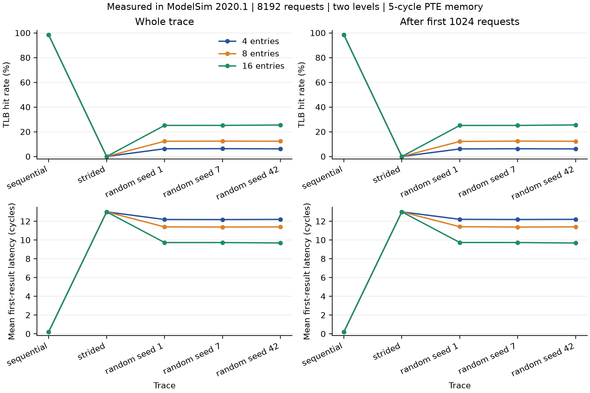
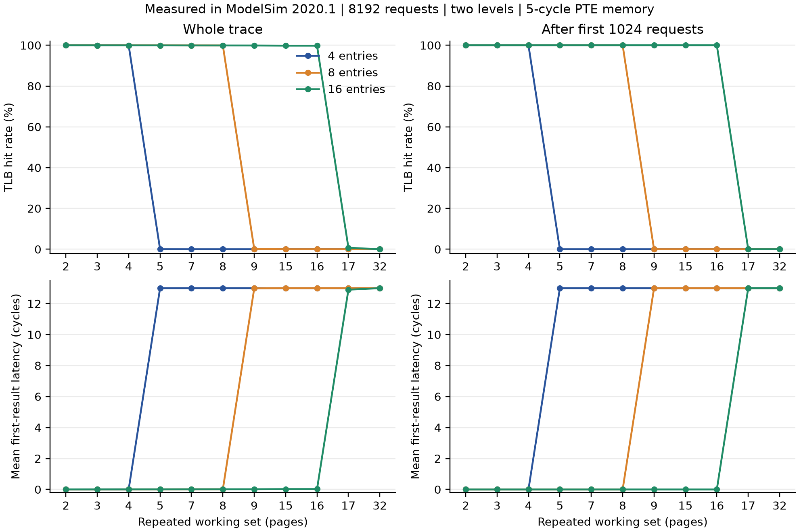

# Measured results

All results below come from ModelSim Intel FPGA Starter Edition 2020.1. The
correctness source is `a1d99ee2c83f29c0ef101bbe72a2f68f06361917`; experiments ran
from `11cec033b13e5b175b98a9b4dbb1744121f301e0`. Their core RTL, benches, generator
and log-checker hashes match. Later evidence/documentation revisions are not
presented as the tested RTL revision.

The [four-page paper](../results/report.pdf), [complete measured CSV](../evidence/performance/metrics.csv),
[experiment manifest](../evidence/performance/experiments.json),
[regression report](../evidence/validation/regression.json),
[coverage reconstruction](../results/coverage.json) and [screenshot index](evidence.md)
provide the detailed records. CSV has 144 rows: 16 traces × 3 capacities × 3 regions.
Every row retains the trace seed/hash, image hash and tested source.

## Validation scope

- 27 positive simulations: exhaustive PLRU, standalone associative TLB and zero-sample metrics at each capacity; plus 18 translation configurations (4/8/16 × seeds 1/7/42 × fixed/variable memory).
- 32,904 PLRU states and 525,344 state/leaf updates; every legal tree state and leaf at each capacity.
- Translation stress: 22,986 accepted, 22,572 completed, 414 deliberately canceled; 21,055,093 procedural checks including the empty runs. First results on subsequently canceled requests are separately accounted for.
- Mandatory explicit bins: 79/83/91 at 4/8/16 in every translation run. Seven wrapper transitions and the specified conflict goals were also reconstructed independently from observed logs.
- 60 malformed/truncated/duplicate/inconsistent log mutations rejected; 19 designated negative tool/checker/coverage/timeout/exit tests failed as required. Expected failures are separate from positive results. Two supplemental duplicate-state injections at 8/16 also failed the intended checker; [records](../results/supplemental/supplemental.json) retain their separate source and exits. The canonical 19 already include the four-entry duplicate test.
- 48 performance simulations, 393,216 accepted and completed translations, no faults/cancellations. Every log was independently replayed and reconciled. Zero-sample rates and means are null, not zero.

The [clean full pipeline](../results/clean-pipeline.json) passed all 14 steps
from source `519062811f0ead885d63d970472e621d4576663e` using checkout/output paths
containing spaces: full regression, 48 experiments, archive verification,
coverage, plots and eight GUI replays. All 144 metric rows match the canonical
rows except source revision; input hashes match exactly.
[validation.json](../results/validation.json) records manifest/artifact hashes and
the retained private location of the original clean-run outputs. The canonical
[archive verification](../results/archive-validation.json) covers 69 successful
logs and 1158 files. Core RTL and verification bytes match the tested sources.

Finite regressions and coverage are not a correctness proof. No upstream defect
reproduction, FPGA validation, synthesis/timing/area/power measurement, CPU/OS
integration, course video or course submission is claimed.

## Controlled inputs and denominators

All capacities replay identical, once-generated bytes. The 10 ns clock, two-level
image/root, five-cycle PTE memory, requester, reset/drain policy and regions are
fixed. Each trace contains 8192 loads. The cold prefix is the first 1024 requests;
the post-warmup region contains the remaining 7168 and retains populated state.
"Post-warmup" does not assert that every trace reaches a stationary regime.

Hit/miss rates divide by accepted lookups in the region. First-result latency is
first sampled response-valid edge minus accepted edge; same-edge hits count zero.
The requester stalls from acceptance until first result. Consumer backpressure and
eligibility queueing are separate and absent from the measured performance stream.
Every performance run checks accepted=completed, hits+misses=accepted, walks=misses,
and summed first latency=translation stall cycles=13×misses. The 13-cycle value
also matches the independently expected two-level `2*L+3` timing with L=5.

Performance image SHA-256:
`728d5da41983bbb588ebcb2ca02652583c3731f2f5826176ae3559c708caaf55`.
Concrete inputs and all per-trace hashes are in
[inputs.json](../evidence/performance/inputs/inputs.json). Fault/protocol and
variable-latency stress are excluded from these performance comparisons.

## Whole-trace measurements

Each cell is **hit rate % / mean first-result cycles / walks / translation stall cycles**.
Miss rate is 100 minus hit rate; exact counts and both rates remain in CSV.

| Trace | 4 entries (baseline) | 8 entries | 16 entries |
| --- | ---: | ---: | ---: |
| sequential | 98.4375 / 0.203125 / 128 / 1664 | 98.4375 / 0.203125 / 128 / 1664 | 98.4375 / 0.203125 / 128 / 1664 |
| strided | 0.0000 / 13.000000 / 8192 / 106496 | 0.0000 / 13.000000 / 8192 / 106496 | 0.0000 / 13.000000 / 8192 / 106496 |
| random_s1 | 6.2622 / 12.185913 / 7679 / 99827 | 12.3291 / 11.397217 / 7182 / 93366 | 25.1587 / 9.729370 / 6131 / 79703 |
| random_s7 | 6.3232 / 12.177979 / 7674 / 99762 | 12.4268 / 11.384521 / 7174 / 93262 | 25.1709 / 9.727783 / 6130 / 79690 |
| random_s42 | 6.1768 / 12.197021 / 7686 / 99918 | 12.3535 / 11.394043 / 7180 / 93340 | 25.4761 / 9.688110 / 6105 / 79365 |
| repeated_w2 | 99.9756 / 0.003174 / 2 / 26 | 99.9756 / 0.003174 / 2 / 26 | 99.9756 / 0.003174 / 2 / 26 |
| repeated_w3 | 99.9634 / 0.004761 / 3 / 39 | 99.9634 / 0.004761 / 3 / 39 | 99.9634 / 0.004761 / 3 / 39 |
| repeated_w4 | 99.9512 / 0.006348 / 4 / 52 | 99.9512 / 0.006348 / 4 / 52 | 99.9512 / 0.006348 / 4 / 52 |
| repeated_w5 | 0.0122 / 12.998413 / 8191 / 106483 | 99.9390 / 0.007935 / 5 / 65 | 99.9390 / 0.007935 / 5 / 65 |
| repeated_w7 | 0.0000 / 13.000000 / 8192 / 106496 | 99.9146 / 0.011108 / 7 / 91 | 99.9146 / 0.011108 / 7 / 91 |
| repeated_w8 | 0.0000 / 13.000000 / 8192 / 106496 | 99.9023 / 0.012695 / 8 / 104 | 99.9023 / 0.012695 / 8 / 104 |
| repeated_w9 | 0.0000 / 13.000000 / 8192 / 106496 | 0.0977 / 12.987305 / 8184 / 106392 | 99.8901 / 0.014282 / 9 / 117 |
| repeated_w15 | 0.0000 / 13.000000 / 8192 / 106496 | 0.0000 / 13.000000 / 8192 / 106496 | 99.8169 / 0.023804 / 15 / 195 |
| repeated_w16 | 0.0000 / 13.000000 / 8192 / 106496 | 0.0000 / 13.000000 / 8192 / 106496 | 99.8047 / 0.025391 / 16 / 208 |
| repeated_w17 | 0.0000 / 13.000000 / 8192 / 106496 | 0.0000 / 13.000000 / 8192 / 106496 | 0.7568 / 12.901611 / 8130 / 105690 |
| repeated_w32 | 0.0000 / 13.000000 / 8192 / 106496 | 0.0000 / 13.000000 / 8192 / 106496 | 0.0000 / 13.000000 / 8192 / 106496 |

## Baseline comparison and cold effects

Positive latency reduction means a lower mean than the four-entry baseline.
Percentage-point hit changes and all region comparisons are retained in CSV.
A zero baseline mean produces null percentage reduction; it is not reported as 0%.

| Trace | 8-entry latency reduction vs 4 (%) | 16-entry latency reduction vs 4 (%) |
| --- | ---: | ---: |
| sequential | 0.0000 | 0.0000 |
| strided | 0.0000 | 0.0000 |
| random_s1 | 6.4722 | 20.1589 |
| random_s7 | 6.5155 | 20.1199 |
| random_s42 | 6.5834 | 20.5699 |
| repeated_w2 | 0.0000 | 0.0000 |
| repeated_w3 | 0.0000 | 0.0000 |
| repeated_w4 | 0.0000 | 0.0000 |
| repeated_w5 | 99.9390 | 99.9390 |
| repeated_w7 | 99.9146 | 99.9146 |
| repeated_w8 | 99.9023 | 99.9023 |
| repeated_w9 | 0.0977 | 99.8901 |
| repeated_w15 | 0.0000 | 99.8169 |
| repeated_w16 | 0.0000 | 99.8047 |
| repeated_w17 | 0.0000 | 0.7568 |
| repeated_w32 | 0.0000 | 0.0000 |

Fitting repeated working sets incur exactly W cold misses and have zero
post-prefix misses. For example, W=16 at sixteen entries has 16 walks over the
whole trace, all in the prefix, and zero post-prefix stalls. Sequential traffic
continues to encounter new pages: its prefix has 16 walks and remaining region
112, with 98.4375% hits in both. Strided traffic misses in both regions at every
capacity. All three random seeds remain separate samples; no population
confidence interval is inferred from them.

## Interpretation and limits

Sequential 64-byte accesses reuse each 4 KiB page 64 times, so larger capacity
has no benefit in this stream. Five-page stride modulo 64 visits every page
before reuse; the working set exceeds every tested capacity. Random occupancy is
consistent with approximately N/64 hit probability; the actual trace bytes and
checked replacement behavior determine the recorded results.

Cyclic sets just above capacity thrash after transient tree-PLRU effects. W=5 at
four entries has one transient hit; W=9 at eight entries has eight; W=17 at sixteen
has 62. These effects are preserved rather than rounded away. Tree PLRU is not a
stack policy: this matrix shows no capacity regression, but does not establish
monotonic improvement for arbitrary traces. No traces or seeds were tuned after
measurement. Capacity thresholds in the approved repeated-set sweep are part of
the experiment, not evidence about general application behavior.

The figure x positions are categorical samples with explicit labels. Native SVGs
are alongside the PNGs. The abstract responder is not a DRAM model, the requester
is not a CPU, and immediate-hit combinational timing has not been physically
characterized. The raw measurements support no CPI/IPC or FPGA implementation claims.
